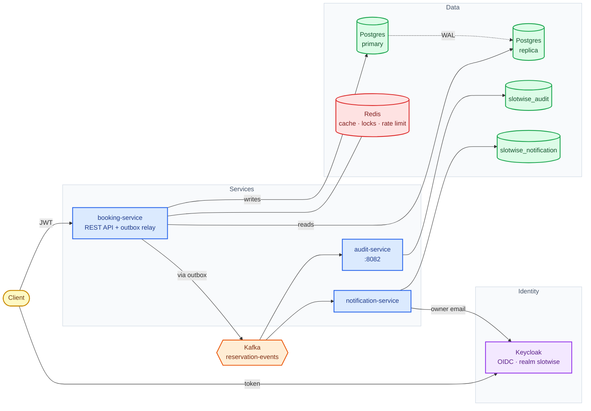
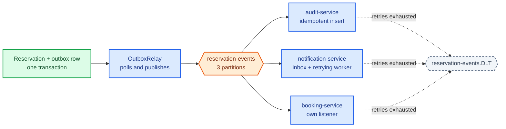
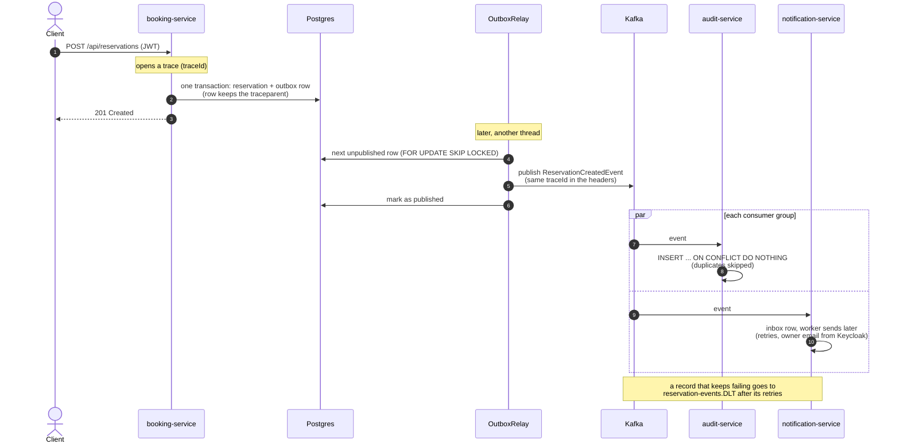

# Slotwise

Booking/reservations platform built as a course project across a backend
learning roadmap (Spring Boot advanced → PostgreSQL → Redis → Kafka → Docker → K8s).

## Stack
Java 25 · Spring Boot 4 · Spring Data JPA · PostgreSQL 17 · Keycloak 26
(OAuth2 Resource Server, JWT) · Testcontainers · Docker Compose

## What it does
- `booking-service` — resources and reservations, secured with Keycloak-issued JWTs mapped to Spring
  Security roles, cached in Redis, rate limited, with a transactional outbox that publishes
  `reservation-created` events to Kafka.
- `audit-service` — consumes those events idempotently into its own database and exposes them to admins.
- `notification-service` — consumes them into an inbox; a worker resolves the owner's email from Keycloak
  and notifies, with configurable retries.
- `slotwise-events` — the shared event contract.

Integration tests run against real Testcontainers (Postgres, Redis, Kafka).

## Architecture

Who talks to whom (blue: services, green: databases, red: Redis, orange: Kafka, purple: Keycloak):



### Events

A reservation becomes an event through the outbox. Each consumer has its own consumer group, and a record that
keeps failing is parked on the dead-letter topic instead of being lost:



### One reservation, step by step

The request, the outbox and both consumers. One `traceId` follows it all the way:



## Run locally
```bash
docker compose up -d      # Postgres (+replica), Redis, Kafka, Keycloak (realm auto-imported)
mvn -pl booking-service spring-boot:run
mvn -pl audit-service spring-boot:run          # optional
mvn -pl notification-service spring-boot:run   # optional
```
See `docs-site/docs/getting-started.md` for tokens, example calls and the one-time database setup on an
existing Postgres volume.
