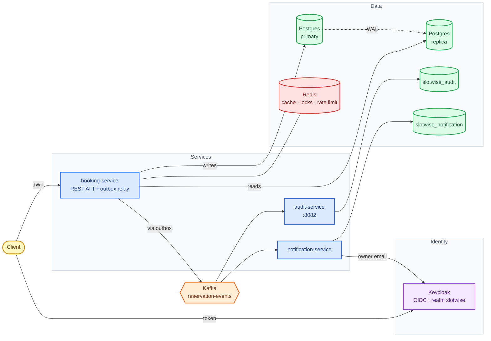
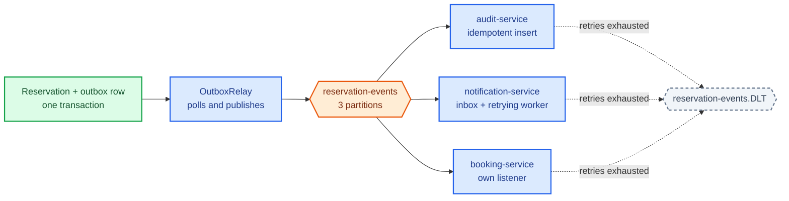
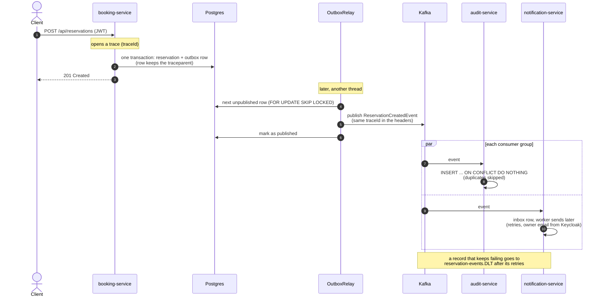

# Slotwise — Career Course Project

Booking/reservations platform used as the hands-on companion to a backend-senior
roadmap: Spring Boot avanzado → PostgreSQL internals → Redis → Kafka → Docker →
Kubernetes.

This site tracks three things as the course progresses:

- **[Getting started](getting-started.md)** — clone it, run it, hit the API locally.
- **[Roadmap](roadmap.md)** — what's done, what's pending, phase by phase.
- **[Decisions](decisions.md)** — non-obvious bugs and design calls worth remembering,
  so a future session (or future me) doesn't re-debug the same thing twice.

## Architecture

Who talks to whom (blue: services, green: databases, red: Redis, orange: Kafka, purple: Keycloak):

### Events

A reservation becomes an event through the outbox. Each consumer has its own consumer group, and a record that
keeps failing is parked on the dead-letter topic instead of being lost:

### One reservation, step by step

The request, the outbox and both consumers. One `traceId` follows it all the way:

!!! note "Source of truth"

    The code lives in `booking-service/`, `audit-service/`, `notification-service/` and the shared
    `slotwise-events/`. This site is a readable view on top of it —
    if the two ever disagree, the code and the git history win.
