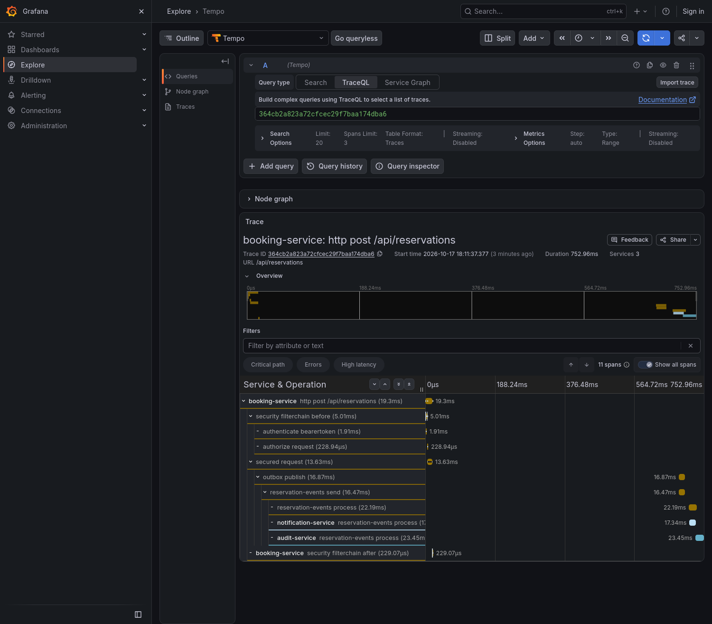
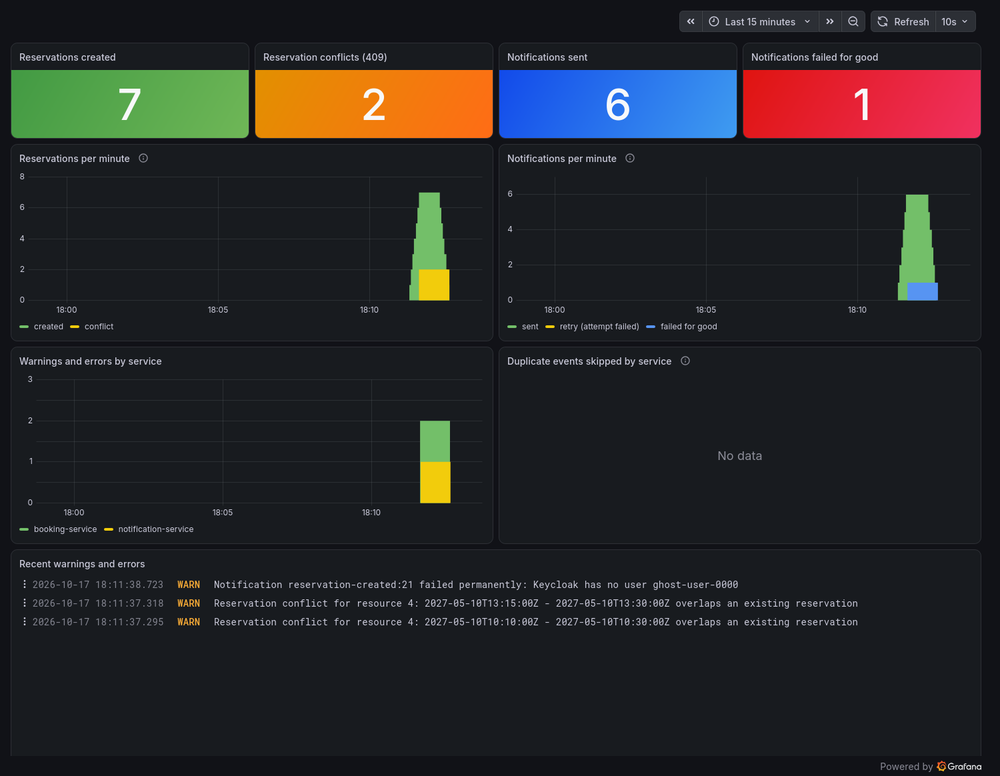
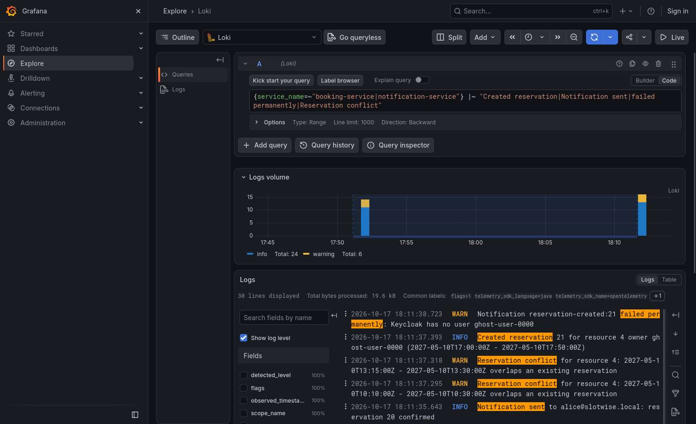

# What we built

Slotwise end to end, with real output from a local run: one request followed through three services, a dashboard built
from the logs, and the tests behind it. Everything below comes from the stack in `docker-compose.yml` and the demo traffic
in `scripts/demo-traffic.sh`.

## One request, followed end to end

A `POST /api/reservations` does three things at once in `booking-service`: it saves the reservation, writes an outbox row in
the same transaction, and answers `201`. A relay publishes the row to Kafka a moment later, and `audit-service`,
`notification-service` and `booking-service` itself consume the event, each in its own consumer group.

The trace below is that whole path as OpenTelemetry recorded it (11 spans, 3 services, 753 ms), shown in Grafana Tempo:



- `http post /api/reservations` and the `security filterchain` spans are the request itself.
- `outbox publish` runs **after** the response, on another thread. The trace still continues: the request's
  `traceparent` is stored in the outbox row and restored by the relay (`OutboxTraceContext`).
- `reservation-events send` is the Kafka producer; the three `reservation-events process` spans are the consumers, one per
  service. A trace that is complete across the outbox is the point of the exercise.

## A dashboard built from the logs

Logs travel by OTLP to an OpenTelemetry Collector and from there to Loki. The dashboard counts the log lines that matter
(`Created reservation`, `Reservation conflict`, `Notification sent to`, `failed permanently`), provisioned from
`grafana/dashboards/slotwise.json`:



The demo traffic behind these numbers (`scripts/demo-traffic.sh`):

| What was sent | Result | Where it shows up |
|---|---|---|
| 6 reservations by `alice` (admin) | `201` | *Reservations created* |
| 1 reservation naming an owner that does not exist in Keycloak | `201` | created, then the notification **fails for good** |
| 2 reservations overlapping an existing one | `409` | *Reservation conflicts* |
| `bob` (user) creating a resource, and booking for someone else | `403` | not in the dashboard: no event is published |
| the emails of the 6 reservations by `alice` | sent | *Notifications sent* (6) |

!!! warning "It counts log text"

    The panels are `count_over_time` over log messages. If someone rewrites `Created reservation`, a panel silently drops
    to zero. Business counters (Micrometer) would be the robust alternative; see
    [Decisions](decisions.md#observability-stack-collector-grafana-lgtm-and-a-dashboard-built-from-logs-fase-4).

## Searching the logs

Every log line carries the `trace_id` and `span_id` of the request, and the logs are ECS JSON on the console. In Grafana's
*Explore* the same lines can be filtered by service and level:



## What the API answers

Real responses from the same run:

```text
POST /api/resources        (alice)  ->  201  {"id":4,"name":"Meeting room Barcelona","description":null,"active":true}
POST /api/reservations     (alice)  ->  201  {"id":15,"resourceId":4,"startTime":"...T09:00:00Z","endTime":"...T09:50:00Z",
                                              "ownerSubject":"<alice's token sub>","status":"CONFIRMED"}
POST /api/reservations     (overlap) -> 409  {"message":"Resource 4 already has an overlapping reservation for that time range"}
POST /api/resources        (bob)    ->  403
POST /api/reservations     (bob, owner = someone else)
                                    ->  403  {"message":"User <bob's sub> cannot book on behalf of someone-else (admin only)"}
```

The `409` is the `reservations_no_overlap` constraint plus a `SELECT ... FOR UPDATE` on the resource row (see Fase 2 in the
[roadmap](roadmap.md)); the `403`s come from Keycloak roles mapped to Spring Security authorities.

## The tests behind it

The last full `mvn test` run: **55 tests, all passing**, against real Testcontainers (Postgres, Redis, Kafka) rather than mocks.

| Module | Tests | What stands out |
|---|---|---|
| `booking-service` | 22 | two concurrent overlapping reservations: only one wins; the request's trace survives the outbox and Kafka (`create_continuesTheRequestTraceThroughOutboxAndKafka`); a poison message does not block the consumer; Redis write-through is immediate |
| `audit-service` | 10 | a duplicate event is stored once; a poison message lands on the dead-letter topic with its original bytes |
| `notification-service` | 19 | the inbox worker's retries, the Keycloak client, idempotent listener |
| `slotwise-kafka-support` | 1 | a record that always fails is retried, then dead-lettered to `reservation-events.DLT` (and it proves the auto-configuration activates itself) |
| `slotwise-observability` | 3 | the default properties are added with the lowest priority, so a service's own config wins |

## Reproduce it

```bash
docker compose up -d                       # Postgres, Redis, Kafka, Keycloak, OTel Collector, Grafana
mvn -DskipTests install
mvn -pl booking-service spring-boot:run    # and audit-service, notification-service in two more terminals
scripts/demo-traffic.sh                    # then open http://localhost:3000 (Dashboards, Explore)
```

!!! note "How these screenshots were taken"

    Grafana was driven by a headless Firefox through Marionette (its automation socket), waiting for the panels to render
    before capturing. They are a snapshot of one local run, not generated by CI.
